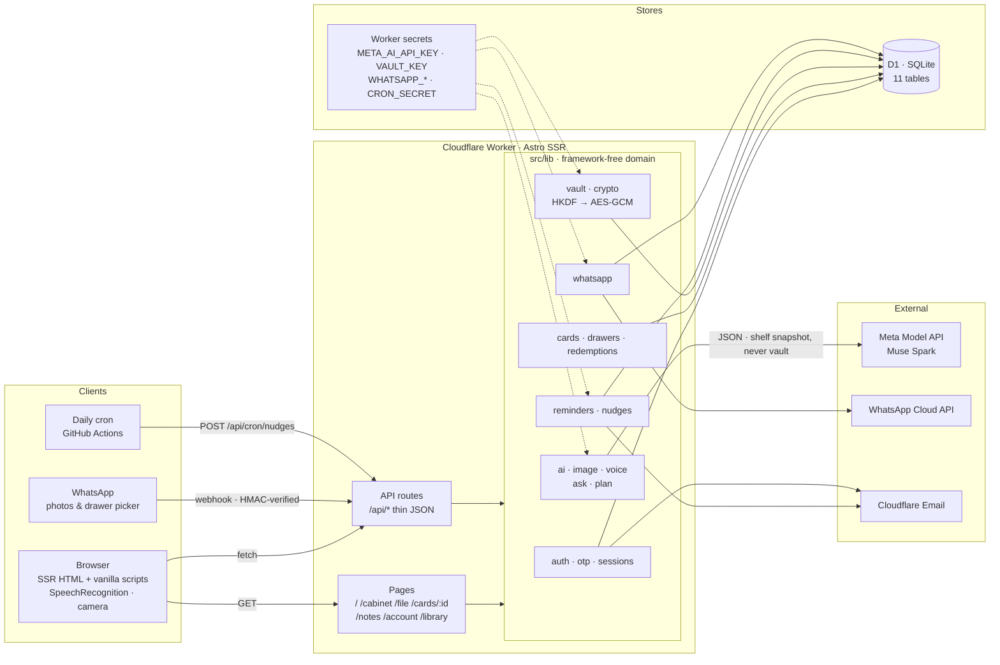
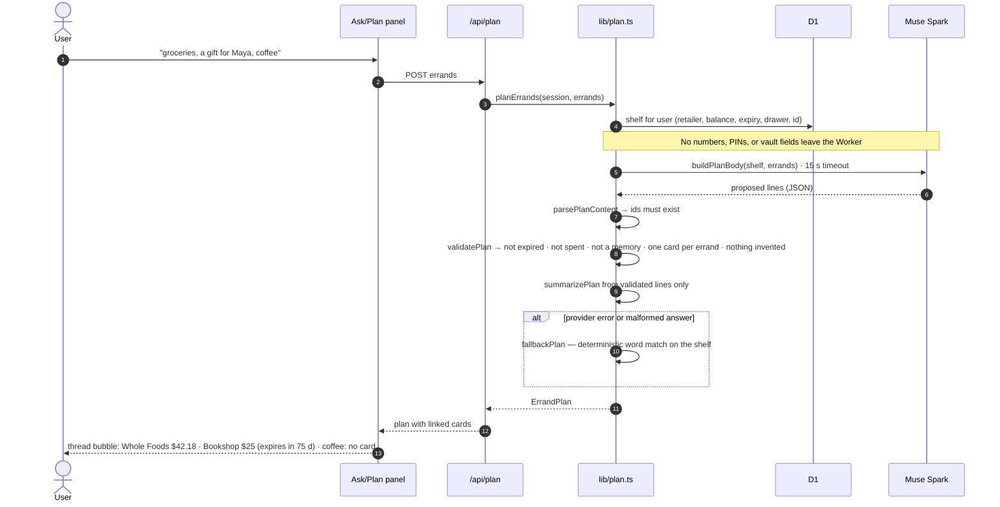
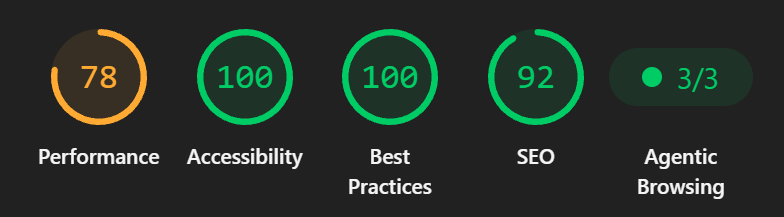

# Gift Cabinet

A gift-card cabinet that helps you actually spend the value you were given. Snap, say, or type a card; file it in a drawer; ask what to spend next in plain words; record what you spent; get a nudge before it expires. Astro SSR on Cloudflare Workers + D1, with Muse Spark (Meta Model API) doing the reading and planning and plain code doing the verifying.

Live at https://gift.dosa.dev. MIT licensed.

## What it does

- **Three ways in.** Photo (vision extraction), voice (browser speech → structured draft), typing, or a WhatsApp message. Every path lands on a draft the user reviews before filing; nothing is saved silently.
- **Drawers you can seal.** Emoji-labelled drawers; a sealed drawer needs its own password and hides its cards. A card's number and PIN live in an encrypted vault that opens only inside an unlocked drawer.
- **Spend, and say so.** "I spent 12" / "Remaining is 18" with a preview, confirm, and 24-hour undo. Every balance change is recorded with before/after values.
- **Ask and Plan.** One conversational panel. *Ask* answers questions grounded in the shelf and cites the cards it used. *Plan* turns "groceries, a gift for Maya, coffee" into a card-by-card plan the code has validated.
- **Nudges.** Email reminders for cards with a confirmed expiry, sent by a daily cron.
- **Library.** A public, SEO-complete blog with retailer guides grounded in the retailers' own help pages.

## Quickstart

Requires Node 22+. Local work needs no Cloudflare account.

```sh
npm install
npm run cf:types
npm run dev
```

In a second terminal, create the local tables once, then seed the demo cabinet:

```sh
npm run db:local
npm run demo:seed
```

Open http://localhost:4321. Sign-up codes print in the page (dev builds skip real email).

Local AI features need `.dev.vars` (gitignored) with `META_AI_ENDPOINT`, `META_AI_MODEL`, `META_AI_API_KEY`, and `VAULT_KEY`. Without the AI values the app still runs fully on manual entry, with deterministic fallbacks for Ask and Plan. Deploying, secrets, and migrations: [docs/operations.md](docs/operations.md).

## Scripts

| Command | What it does |
| ------- | ------------ |
| `npm run dev` | Local dev server |
| `npm run build` | Production build |
| `npm run check` | Astro + TypeScript checks (must be 0 errors) |
| `npm run test` | Unit tests (Vitest, 25 files / 295 tests) |
| `npm run test:e2e` | Browser tests (Playwright, 19 specs) |
| `npm run demo:seed` | Sign in as the demo account and seed its cabinet (dev only) |
| `npm run db:local` | Apply `schema.sql` to local D1 |

## Architecture



Everything the model sees and everything that touches money passes through `src/lib`, where the rules live and the tests are. The sequence below is the pattern every AI feature follows:



Public pages (`/signin`, `/signup`, `/404`) are prerendered; everything else renders per request.

### Routes

| Path | Purpose |
| ---- | ------- |
| `/` | Signed-out landing (prerendered-style, static copy) or the signed-in dashboard with recent activity |
| `/cabinet` | The drawers: furniture UI, filters, Ask/Plan panel, seal/unseal |
| `/file` | Snap, speak, or type a card; review the draft; file it |
| `/cards/[id]` | Detail, quick balance update + undo, vault reveal, memories, reminders |
| `/notes` | To-dos tied to the cabinet |
| `/account` | Auto-saving profile, region/currency/date format, WhatsApp linking |
| `/library`, `/library/[slug]` | Public blog: guides and articles |
| `/api/*` | Thin JSON endpoints over `src/lib` (see below) |

API groups: `auth/*` (OTP request/verify, session, sign-out), `cards`, `cards/[id]`, `cards/[id]/vault`, `cards/[id]/redemptions`, `drawers` + `lock|unlock|relock`, `extract` (photo), `voice/extract`, `ask`, `plan`, `todos`, `profile`, `samples`, `dashboard`, `whatsapp/*`, `cron/nudges` (secret-guarded), `dev/demo` (404 outside `astro dev`).

### `src/lib` modules

| Module | Responsibility |
| ------ | -------------- |
| `auth`, `otp`, `email` | Passwordless sign-in: 6-digit OTP by email, signed session cookie, `AuthError` with HTTP status |
| `db`, `fake-db` | Thin D1 wrapper and an in-memory stand-in for unit tests |
| `cards`, `drawers`, `seed`, `demo` | Cards and drawers CRUD, PBKDF2 drawer seals with attempt throttling, starter samples, the storybook demo cabinet |
| `vault`, `crypto` | Card number/PIN at rest: AES-GCM with a per-user key derived via HKDF-SHA-256 from `VAULT_KEY`; versioned ciphertext (`v1.`) |
| `redemptions` | Balance changes: `manual` (quick update) and `edit` (form) rows with before/after, undo rules |
| `ai`, `image` | Muse Spark client, photo downscaling, extraction cleanup |
| `voice` | Spoken transcript → structured draft with `needsReview` flags |
| `ask`, `plan` | Shelf-grounded Q&A and errand planner, both with code-side validation and fallbacks |
| `reminders`, `nudges` | Expiry reminders; claim-before-send so a cron retry never double-emails |
| `whatsapp` | Webhook verification, signature check, media download, interactive drawer picker, filing |
| `prefs`, `format`, `stores` | Region/currency/date preferences, money and date formatting, retailer → domain map for logos |
| `library` | Content-collection helpers, read time, deterministic featured art |
| `throttle` | Per-key rate limiting for OTP, WhatsApp, and AI endpoints |

Every module has a colocated `*.test.ts`.

### Data

D1 tables: `users`, `otp_codes`, `sessions`, `drawers`, `cards`, `reminders`, `prefs`, `todos`, `whatsapp_links`, `whatsapp_pending`, `redemptions`. Every `redemptions` row keeps `before_cents`, `after_cents`, and `kind` (`manual` quick update or `edit` form change), so balance history is complete without a ledger UI.

### Security posture

- No secrets reach the browser. The model key, WhatsApp token, and vault key live in Worker secrets and are used server-to-provider only.
- Card numbers and PINs are encrypted at rest and decrypted only for a reveal inside an unlocked drawer. They are never included in anything sent to the model, in Ask/Plan context, in logs, or in the public Library.
- Drawer seals use PBKDF2 with per-drawer salt and attempt throttling; sealing hides contents plus rename/delete.
- Ownership is checked on every row access; the server, not the client, computes balances.

## AI: Muse Spark via the Meta Model API

Four server-side chat-completions calls, each with a 15 s timeout and a non-AI path when the provider is unavailable. The model proposes; code decides.

| Call | Input to the model | What code does with the answer |
| ---- | ------------------ | ------------------------------ |
| **Snap** (`image.ts`, `ai.ts`) | A downscaled card photo | Normalises retailer/amount/expiry into a draft. The user reviews and confirms; number/PIN are not extracted into the draft. |
| **Voice** (`voice.ts`) | Browser `SpeechRecognition` transcript + drawer names, default currency, today's date | Builds a draft, resolves relative dates, and flags anything uncertain (bare "dollars", unmatched drawer, ambiguous expiry) in `needsReview`. Users are never asked to speak a number or PIN. |
| **Ask** (`ask.ts`) | A JSON shelf snapshot: retailer, balance, expiry, drawer, card id — nothing from the vault | Requires every claim to cite a card id. Uncited or malformed answers fall back to a deterministic shelf summary. |
| **Plan** (`plan.ts`) | The same shelf plus up to eight errands | `parsePlanContent` → `validatePlan`: ids must exist; no expired, spent, or memory cards; one card per errand; no invented retailer, amount, or date. `summarizePlan` writes the final text from validated lines. If the model fails, `fallbackPlan` matches by words. |

Why this split: a wrong gift-card balance is money lost. The model is good at reading photos, speech, and intent; arithmetic, eligibility, and ownership are checked in TypeScript with unit tests.

## WhatsApp channel

A second front door over the same cabinet. The Account page issues a `LINK` code for a digits-only number; sending it in chat verifies the number (`whatsapp_links`). Photos download from the Graph API, run through the same snap pipeline, and reply with an interactive drawer list (Personal + open drawers; sealed drawers hidden) backed by a one-shot `whatsapp_pending` row. Picking a drawer files the card; Discard drops it.

The webhook verifies Meta's `X-Hub-Signature-256` on every payload and rate-limits each number, so a forged message cannot file a card.

## Design system and motion

- **Tokens** in `src/styles/tokens.css`: OKLCH palette (milk-white page, warm paper panels, lime and teal accents), one 1200 px container shared by every page, fluid gutters. Fonts (Geist Serif, Figtree variable, IBM Plex Mono) are self-hosted from `public/fonts`; first paint makes no third-party requests.
- **Illustrations**: eight compositions, one per page type, rendered server-side by `MotionFigure.astro` from a typed `SceneId` → inline SVG map (`scenes.ts`). Each scene plays a 1.4–1.8 s one-shot choreography (transform/opacity only) when it first becomes visible, pauses offscreen and in background tabs, does not replay within a session, and is a complete still image without JavaScript or under `prefers-reduced-motion`.
- **Budgets enforced by tests** (`scenes.test.ts`): each route's SVG ≤ 2 KiB gzip, shared motion CSS ≤ 2 KiB gzip, lifecycle controller ≤ 1 KiB gzip.
- **Background**: a sparse engraved gift-tag pattern as an inline SVG data URI (~1 KB of CSS), switched off under `prefers-contrast: more`.
- Decorative SVG is `aria-hidden` and non-focusable, and never contains real balances or numbers.

## Public Library

`src/content/library/*.md` via Astro content collections. Index with search and topic filters; article pages with table of contents (collapsible on phones), share links, related reading, FAQ, and a CTA. Each article gets deterministic featured art: an FNV-1a hash of the slug picks a token gradient pair, angle, and emoji, so tiles are stable across builds with no image requests. SEO: canonical URLs, Open Graph, sitemap, robots, and Article / FAQPage / BreadcrumbList JSON-LD.

Retailer guides (Amazon, Target, Walmart, Starbucks, Apple, Meta Quest) are written from the retailers' own help pages and terms, separate real gift cards from promotional credits, return cards, and prepaid cards, and carry a "checked on" date with the retailer's page as the source of truth.

## Reliability and performance



- `astro check` clean; 295 unit tests across 25 files; 19 Playwright specs covering every screen, auth, drawers, vault, redemptions, ask/plan, voice, WhatsApp webhook, nudges, library, motion lifecycle, and layouts at 320 / 390 / 1440 px.
- Lighthouse (mobile, production): Accessibility 100, Best Practices 100, SEO 92 (the one flagged link now has a descriptive name), CLS 0, and 3/3 on Agentic Browsing. Fonts are self-hosted, so first paint makes no third-party requests; the remaining render-blocking assets are two small stylesheets (~12 KB). Browser extensions inflate TBT in profiled runs; audit in Incognito.
- Every feature degrades: no JS → still images and working forms; no AI key → manual entry plus deterministic Ask/Plan; no email → OTP shown in dev.

## Tradeoffs

- SSR-first Astro with vanilla client JS instead of a SPA framework: fast first paint and simple pages, at the cost of full-page reloads after most mutations.
- D1 for everything (auth, data, prefs): one binding, zero extra services; expiry nudges need an external daily cron hitting the guarded endpoint.
- AI as proposer, not authority: slightly more code per feature, but no balance or eligibility decision depends on model output.
- No retailer balance scraping, by design: the app records what the user confirms rather than making claims it cannot back.
- Store logos via Google's favicon service with a curated retailer → domain map; unknown shops keep a monogram rather than risk a wrong logo.
- Sealed drawers hide contents and rename/delete, but the header emoji is cosmetic metadata and stays changeable without unlocking.

## Demo account

`npm run demo:seed` signs in as `demo@gift.dosa.dev` (dev shows the OTP code on screen) and seeds Diya's cabinet: Everyday, Birthdays, Travel, Keepsakes, and a sealed Family drawer with a vaulted Amazon card; twelve cards across filed, due-soon, spent, and memory; a recorded Starbucks spend so the "Last update … Undo" line shows; reminders; three notes.

A route that shows most of it in three minutes: `/` → `/file` (say a card) → `/cabinet` (open the Family drawer) → the Steam card (due pill, quick update, undo) → Ask "what expires first?" → Plan "groceries, a gift for Maya, coffee" → `/library`.

## License

MIT — see `LICENSE`.
